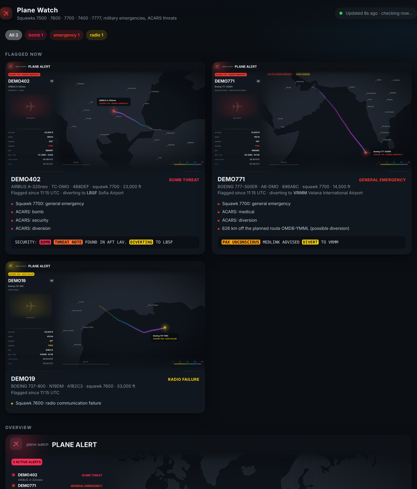
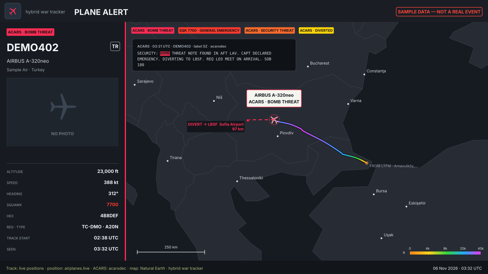
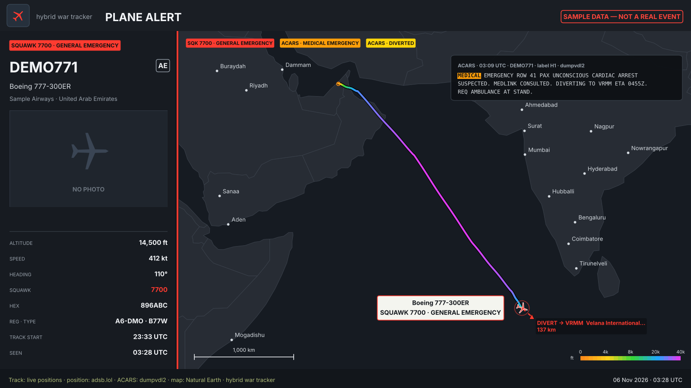

# Social-media-analysis

Finds what people are talking about on **YouTube, X/Twitter, Facebook and Instagram**, and publishes the results to a GitHub Pages site:

**https://inasjackw321.github.io/Social-media-analysis/**

The posts are scraped with [Scrapling](https://github.com/D4Vinci/Scrapling). The app then groups the posts into topics: keyphrases and hashtags that several different accounts use, ranked by engagement and by how many platforms mention them. Each scan is saved to `site/data/`, so the site keeps a history you can switch between. Topics that weren't in the previous scan are marked **new**.

## Running a scan

**Ask Claude:** for example, *"scan social media for topics about the election"* or *"look through social media for what's trending"*. Claude starts the workflow, waits for it to finish, and sends you a summary with a link to the report. [`CLAUDE.md`](CLAUDE.md) explains how.

**Run it yourself:** go to **Actions → Scan social media → Run workflow**. You can give it:
- `query`: comma-separated search terms. Leave it blank to analyse the latest posts from the accounts in `config.json`.
- `platforms`: any of `youtube,twitter,facebook,instagram`.
- `lookback_hours`: how far back to look (default 24).

**Run it locally:**
```bash
pip install -r requirements.txt && scrapling install
python -m social_topics scan --query "ai, climate" --platforms youtube,instagram
python -m http.server -d site   # then open http://localhost:8000
```

## What gets scraped

| Platform | No login needed | Optional secret, which also enables keyword search |
|---|---|---|
| YouTube | Search results for your terms, plus the RSS feeds of the channels in `config.json` | — |
| X / Twitter | Recent posts from `twitter.accounts`, via X's public embed timeline | `X_AUTH_TOKEN` (plus `X_CT0` if needed): a stealth browser searches x.com |
| Instagram | Latest posts from `instagram.accounts` | `INSTAGRAM_SESSIONID`: searches each term as a hashtag |
| Facebook | Public Page feeds from `facebook.pages`, read with a stealth browser | `FACEBOOK_COOKIES` (`c_user=…; xs=…`): full feeds and post search |

To get one of these values, log in to the site in your browser and open DevTools → Application → Cookies. Then add the value under **Settings → Secrets and variables → Actions**. **Use a spare account, not your main one**, because platforms can rate-limit or lock accounts that scrape.

You can edit the accounts, pages and channels to watch in [`config.json`](config.json).

**Known limits.** The platforms change their pages often and limit logged-out visitors, so expect some failures. If a platform fails or is skipped, the report still covers the other platforms, and it says what went wrong with each one. Facebook doesn't show post dates to scrapers, so the lookback window can't filter Facebook posts. Scraping may go against a platform's terms of service, so use this for personal research.

## One-time setup

1. Merge this into `main`. GitHub only lets you run workflows that are on the default branch.
2. **Settings → Pages → Build and deployment → Source: GitHub Actions.**
3. Optional: add the login secrets above.

## Layout

```
social_topics/
  scrape.py          Scrapling wrappers (Fetcher for HTTP, StealthyFetcher for JS pages)
  collectors/        one scraper per platform
  topics.py          topic extraction
  report.py          writes site/data/index.json and site/data/reports/<id>.json
site/                the GitHub Pages site (static HTML/JS)
config.json          what to watch
.github/workflows/   scan.yml (scan + deploy), tests.yml
```

To run the tests: `python -m unittest`

---

# Plane watch

One app that watches for aircraft in an emergency and draws a card for each one.

## Start and stop it whenever you want

On Windows, in the downloaded folder:

- **Start Plane Watch.bat**: double-click it. Plane Watch runs in the background (no window to keep open) and the dashboard opens in your browser. If it's already running, this just opens the dashboard.
- **Stop Plane Watch.bat**: double-click it to shut Plane Watch down.

On macOS or Linux, use `start-planewatch.command` and `stop-planewatch.command`.

The dashboard has buttons for the same things: **Pause** (stop checking until you press Resume), **Check now**, and **Stop**. Your cards and history stay in `planewatch-data/` between runs. When it runs in the background, its log is `planewatch-data/planewatch.log`.

## Run it: one command

1. Download **[planewatch.pyz](https://github.com/Inasjackw321/hybrid-war-tracker/releases/latest/download/planewatch.pyz)**. You need Python 3.9 or newer.
2. Run it:

   ```bash
   python planewatch.pyz
   ```

The first run takes about a minute because it installs matplotlib and airportsdata into a private folder (`~/.planewatch`). It doesn't change your system Python. After that it opens a live dashboard in your browser at <http://localhost:8787>. It checks again every minute and updates the page itself. Press Ctrl+C to stop.

You can also run `python planewatch.py` from a downloaded copy of this repo.



## What it looks for

It checks for all of these, every cycle:

- **Emergency squawks**: 7500 hijack, 7600 radio failure, 7700 general emergency. It also reads the emergency status the transponder broadcasts (general, medical, low fuel, no radio, hijack, downed), including on military aircraft. 7400 (drone lost link) and 7777 (US military intercept) aren't watched by default; add them with `--squawks 7500,7600,7700,7400,7777`. Positions come from the free [adsb.lol](https://adsb.lol), [airplanes.live](https://airplanes.live) and [adsb.fi](https://adsb.fi) feeds.
- **ACARS threats**: bomb threats, hijacking, security problems and unruly passengers, mayday/pan-pan, fire/smoke, engine or pressure failures, medical emergencies, low fuel, and **diversions**. When a message names the airport (`DIVERTING TO LBSF`), the card draws a line to it.
- **Off-route aircraft**: a flagged aircraft more than 300 km off its planned route gets a *possible diversion* flag.

The dashboard counts how many aircraft are squawking 7700, 7600 and 7500 right now, and lists every 7700 from the last 24 hours.

### Military activity

While it runs, Plane Watch records every military aircraft the feeds report (one position every 2 minutes, kept for 8 days, in `planewatch-data/data/tracks.sqlite`). From that it builds, every 10 minutes:

- **A heatmap** of military positions over the last 24 hours or 7 days, with the most seen types and busiest airfields.
- **Where they go**: every flight split at landings and long gaps, with the nearest airfield at each end, plus tables of the busiest airfields, types, operators and individual aircraft. They're on the dashboard and saved as CSV.
- **Ospreys and H-60s**: the last position of every V-22 Osprey and H-60 (Black Hawk / Seahawk family, which includes the MH-60) seen in the last 24 hours, on a map and in a table. Change the types with `--watch-types`.

**History on start:** each time it starts, it downloads the last 24 hours of track history (from the feeds' trace files) for every military aircraft, Osprey and H-60 it can see. That way the heatmap and tables aren't empty at first. The dashboard shows the download's progress. It only finds aircraft the feeds show at the moment, so anything older than that, or aircraft that have switched off, comes from leaving Plane Watch running.

**Ground tests:** an aircraft squawking an emergency code while parked or taxiing, which wasn't seen flying with it, is listed separately as "on the ground, probably a test". It's left off the emergency map and counters. Airbus and Boeing test aircraft (F-WZ…, N-numbers at Everett) do this a lot.





*(The pictures above use made-up sample data.)*

### Adding ACARS

- **Your own receiver:** the app listens on **UDP port 5550** for decoder JSON. Point your decoder at the computer running Plane Watch. For example, acarsdec: `--output json:udp:host=127.0.0.1,port=5550`. dumpvdl2 or dumphfdl: `--output decoded:json:udp:address=127.0.0.1,port=5550`. ACARS Hub's feeders work the same way.
- **A file:** `python planewatch.pyz --acars-file acars.jsonl`
- **airframes.io:** set the environment variable `AIRFRAMES_API_KEY` before you start the app.

### Tracking

- **Watchlist**: type a hex code (AE6808), callsign (RCH123) or registration (N123AB) into the dashboard's Watchlist box. That aircraft is looked up every check and gets its own live card with its track; the last 24 hours of its track are downloaded when it's first found. Remove it with ×. You can also add aircraft at startup with `--watch AE6808`. Up to 25 aircraft.
- **Aircraft details**: click any row in the "Where military aircraft go" Flights or Aircraft tables (or "Flights & history" on a watchlist card) to see that aircraft's flights, airfields and distance over the last 7 days, and add it to the watchlist.
- **Desktop notifications**: press 🔔 Alerts at the top of the dashboard. You get a notification and a short chime when a new emergency appears or a watched aircraft becomes visible. The dashboard tab has to stay open.

### Watermark

Every graphic carries **@Kaldockhi** in the top right, plus a faint copy over the map. Change it with `--watermark "@yourname"`, or turn it off with `--watermark ""`.

## What it saves

Everything goes in `planewatch-data/` (change it with `--out`):

| File | What |
|---|---|
| `cards/<hex>.png` | the latest 1600×900 card for each flagged aircraft |
| `cards/overview.png` | the emergency map: aircraft in an emergency now, plus (dimmed) the ones from the last 6 hours |
| `data/map_recent.json` | what the emergency map remembers, so it survives restarts |
| `data/alerts.csv` | one row per alert, ready for a spreadsheet or pandas |
| `data/history.json` | every alert seen, with first and last time seen |
| `data/acars_flagged.jsonl` | every flagged ACARS message |
| `data/live.json` | the current state, which the dashboard reads |
| `data/tracks.sqlite` | recorded military positions (last 8 days) |
| `cards/military-heatmap-24h.png`, `-7d.png` | military heatmaps |
| `cards/watched-24h.png` | Ospreys and H-60s, last 24 hours |
| `data/military_flights_24h.csv`, `_7d.csv` | every military flight: start, end, from and to airfield, distance |
| `data/military_airfields_*.csv`, `military_aircraft_*.csv` | busiest airfields; per-aircraft totals |

## Options

`python planewatch.pyz --help` lists them all. The useful ones:

| Option | Default | |
|---|---|---|
| `--interval` | 60 | seconds between checks |
| `--squawks` | 7500,7600,7700 | squawk codes to watch |
| `--watch-types` | V22,H60 | aircraft types mapped at their last position over 24 h |
| `--watch AE6808` | | add an aircraft to the watchlist (repeatable) |
| `--watermark` | @Kaldockhi | text on every graphic |
| `--backfill-hours` | 24 | history downloaded on start (0 turns it off) |
| `--record-days` | 8 | how long military positions are kept |
| `--summary-minutes` | 10 | how often the heatmaps and tables are rebuilt |
| `--keep-hours` | 6 | how long an aircraft stays on the emergency map after its emergency ends |
| `--background` | | run with no terminal window (what Start Plane Watch.bat does) |
| `--stop` | | stop a Plane Watch that's running in the background |
| `--port` | 8787 | dashboard port |
| `--udp-port` | 5550 | ACARS listener (0 turns it off) |
| `--once` | | check once, save, and exit |
| `--no-browser` | | don't open the browser |

Other commands:
- `demo`: sample cards, no internet needed
- `render --hex AE6808`: a card for any aircraft
- `scan`: a one-off scan that saves dated reports, which the GitHub workflow uses
- `classify "TEXT"`: shows what the ACARS rules match

## Also on GitHub Actions

**Actions → Plane watch → Run workflow** runs a scan in the cloud and publishes the cards to the Pages site at `/planes/`. **Build Plane Watch app** rebuilds `planewatch.pyz` and publishes it as the download above whenever `plane_watch/` changes on `main`.

**Caveats.** A 7x00 squawk is sometimes a pilot dialling the wrong code for a moment. ACARS keyword matching finds words, not intent. The common planning and test phrasing is filtered out, but check the evidence on each card before treating it as confirmed. The country comes from the aircraft's ICAO address block. Some networks block the community ADS-B feeds; the dashboard lists any source that failed.

## Layout

```
planewatch.py        launcher: installs dependencies on first run, then starts the app
plane_watch/
  app.py             the live app: polling loop, UDP ACARS listener, local dashboard
  web/index.html     the dashboard
  sources/           ADS-B feeds, ACARS (decoders + airframes.io), planespotters photos
  classify.py        squawk / emergency / ACARS keyword rules
  pipeline.py        builds and enriches alerts, writes data files
  tracker.py         records military aircraft, works out flights, airfields, heatmap points
  render.py          the cards and the overview map
  basemap.py         Natural Earth land + cities (downloads 1:50m, falls back to bundled 1:110m)
tools/build_app.py   builds dist/planewatch.pyz
```
